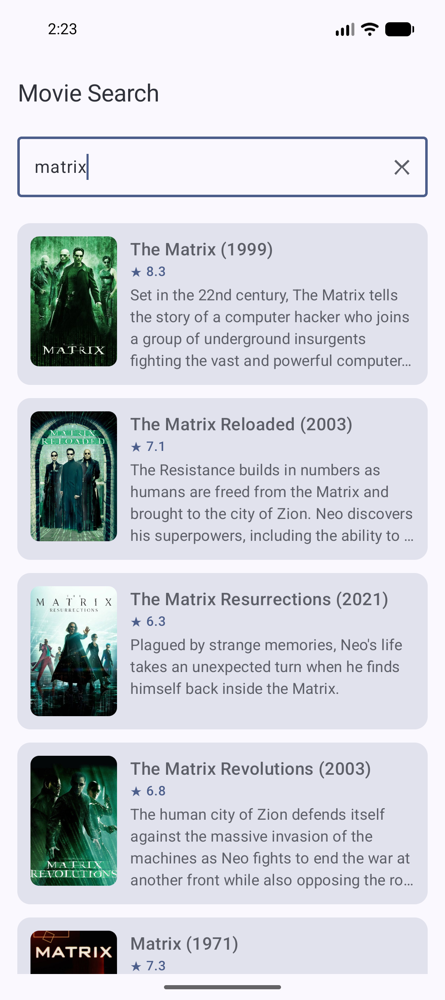
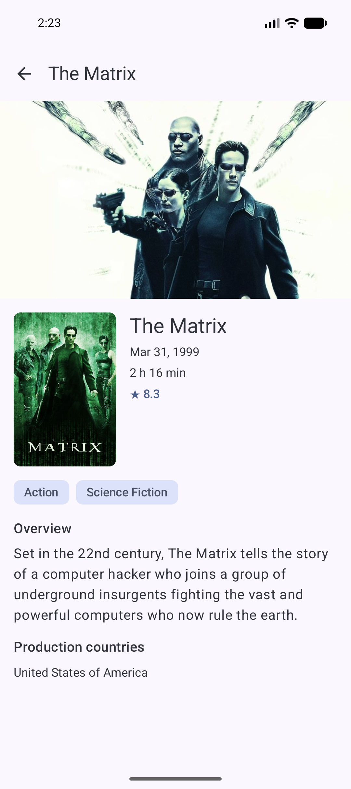
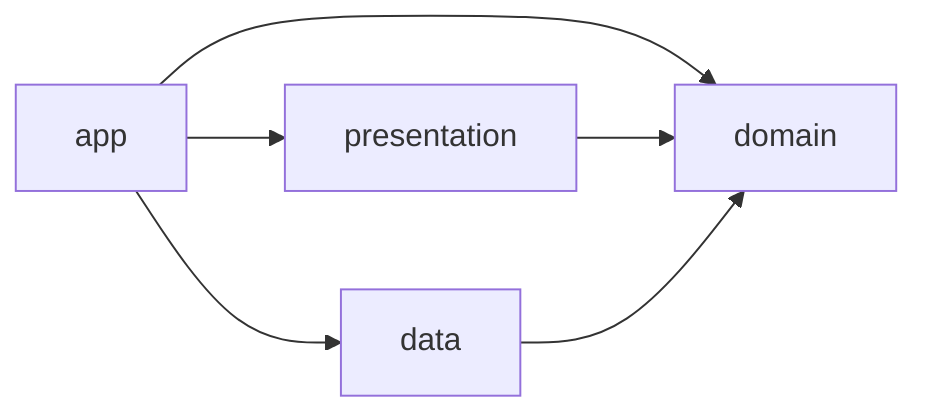
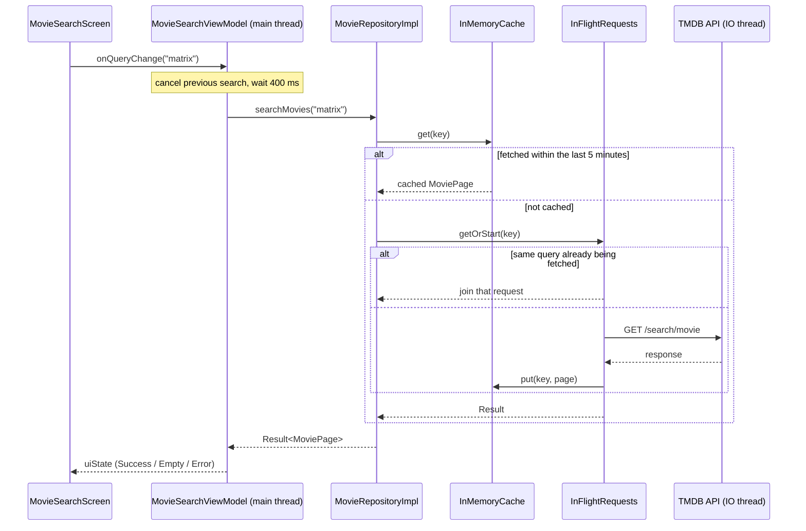

# MovieSearch

An Android app for searching movies on [The Movie Database (TMDB)](https://www.themoviedb.org/) and viewing their details. It's built with Jetpack Compose, a multi-module clean architecture, and Kotlin coroutines. Search results are cached in memory, identical concurrent requests are shared, and searches that are no longer needed are cancelled.

<p>
  
  &nbsp;&nbsp;
  
</p>

## Features

- **Search as you type.** The search starts 400 ms after the user stops typing, so not every keystroke sends a request. An **✕** button clears the query.
- **Results list** with poster, title, year, rating and overview.
- **Movie detail screen** with backdrop, poster, release date, runtime, rating, genres, overview and production countries.
- **Loading, empty and error states.** Error messages say what went wrong (no connection, missing or invalid API key, TMDB server problem), and **Retry** is offered whenever retrying can help.
- **In-memory cache for search results.** Repeating a query within 5 minutes doesn't use the network.
- **Request sharing.** Identical searches started at the same time cause a single HTTP request.
- **Cancellation.** Typing a new query cancels the previous search, including its HTTP request, and a stale result is never shown.

## Tech stack

| Area | Library |
|---|---|
| UI | Jetpack Compose (Material 3), Navigation Compose 2.10 with type-safe routes |
| Dependency injection | Hilt 2.60 (with KSP) |
| Networking | Retrofit 3, OkHttp 5, kotlinx.serialization 1.12 |
| Asynchronous work | Kotlin coroutines 1.10 and `StateFlow` |
| Images | Coil 3 |
| Testing | JUnit 4, kotlinx-coroutines-test, OkHttp MockWebServer |
| Build | Gradle 9.6, AGP 9.5, Kotlin 2.4, Gradle version catalog (`gradle/libs.versions.toml`) |

`minSdk` 26, `targetSdk` and `compileSdk` 37.

## Getting started

1. Get a free TMDB API key at <https://www.themoviedb.org/settings/api>.
2. Add it to `local.properties` in the project root. This file is git-ignored, so the key never ends up in version control:
   ```properties
   TMDB_API_KEY=your_api_key_here
   ```
   As an alternative, the build also reads a `TMDB_API_KEY` environment variable (useful for CI).

   If no key is set, the build prints a warning, and the app shows a "TMDB API key is missing or invalid" message instead of results.
3. Open the project in Android Studio (2026.2 or newer) and run the `app` configuration, or from the command line:
   ```bash
   ./gradlew :app:installDebug
   ```

## Architecture

The project is split into four modules, following clean architecture:



| Module | Type | Responsibility |
|---|---|---|
| `domain` | Pure Kotlin (no Android) | Models (`Movie`, `MovieDetail`, `MoviePage`), the `MovieRepository` interface, and the use cases (`SearchMoviesUseCase`, `GetMovieDetailUseCase`). |
| `data` | Android library | Implements `MovieRepository`: the TMDB API (Retrofit), API data classes and mappers, the search cache, request sharing, and the Hilt modules that provide all of these. |
| `presentation` | Android library | Compose screens, Hilt ViewModels, UI state, theme (including the `Size` and `ComponentSize` scales), and each screen's navigation pieces. |
| `app` | Application | The composition root: `Application` class (Hilt, Coil image loader), `MainActivity`, and the `NavHost` that connects the screens. |

Key rules:
- **`domain` depends on nothing.** `presentation` and `data` both depend on `domain`, never on each other. Data errors reach the ViewModels as `Result.failure` holding a `DataError` (`Network`, `InvalidApiKey`, `Server` or `Unknown`), not as exceptions. The data layer translates networking exceptions into these (`ErrorMapper.kt`), and the UI turns them into a message and decides whether to offer Retry (`ErrorReason`).
- **Screens don't know about each other.** Each screen offers a `NavGraphBuilder` function, such as `movieSearchScreen(onMovieClick)`. The app's `MovieSearchNavHost` decides that tapping a movie opens its details.
- **`app` depends on `data` and `domain`** only because Hilt generates the app-wide dependency graph inside `app`, and it needs every module that contributes classes to that graph.

### `data` module layout

```
data/
├── cache/        InMemoryCache (TTL + LRU), SearchCacheKey
├── concurrency/  InFlightRequests (shares identical in-flight requests)
├── di/           NetworkModule, CacheModule, CoroutinesModule, RepositoryModule
├── mapper/       API data classes -> domain models
├── remote/       TmdbApi, NetworkFactory, TmdbImageUrl, interceptor/, model/ (API data classes)
└── repository/   MovieRepositoryImpl
```

## Caching, concurrency and cancellation

### What happens during a search



### Caching: `data/cache/InMemoryCache.kt`

- **5-minute expiry**, counted from when the entry was stored. Reading an entry doesn't extend its life, so results are never older than 5 minutes. (The requirement allows 2–5 minutes; the value is a constant in `CacheModule`.)
- **Monotonic clock** (`TimeSource.Monotonic`): changes to the device's wall clock can't make entries expire early or live forever. Tests replace it with `TestTimeSource`.
- **At most 50 entries.** When full, the least recently used entry is dropped (`LinkedHashMap` in access order).
- **Expired entries are removed when they're read.** No timers or background jobs are needed.
- **Normalized keys:** `SearchCacheKey` trims and lowercases the query (TMDB search ignores case) and includes the page number.
- **Only successful results are cached.** A failure is never stored, so Retry always tries the network again.
- **Thread-safe.** `get` and `put` are `@Synchronized`: the cache is read on the main thread and written from IO threads. A plain lock is enough because the locked code never suspends.
- The cache lives in the data layer. Use cases and ViewModels don't know it exists.

### Concurrency

- **The repository is safe to call from the main thread.** Network calls, JSON mapping and cache writes run on an injected `@IoDispatcher`, provided in `CoroutinesModule` so tests can substitute a test dispatcher.
- **Request sharing** (`data/concurrency/InFlightRequests.kt`): when a search for a key is already in flight, new callers wait for that request instead of starting another. Ten simultaneous searches for "matrix" (in any capitalisation) make **one** HTTP call, and the result is cached once.
  - The shared request runs in an app-wide `@ApplicationScope` (with a `SupervisorJob`, on the IO dispatcher), not in the coroutine of whichever caller came first. One caller being cancelled therefore can't cancel the request for everyone else.
  - The map of in-flight requests is protected by a lock, which is never held while a coroutine is suspended.
  - The request is created lazily and started only after it has been stored in the map, so it can't finish before it's registered.
  - After the cache check, the repository checks the cache a second time inside the shared request. The cache is written before a request completes, so a search that just misses a finishing request finds its result in the cache instead of sending a duplicate request.
- **ViewModel state** (`StateFlow`) is only updated on the main thread. Searches overlap in time, but they take turns on the main thread rather than running in parallel.

### Cancellation

- **A new query cancels the previous search.** `MovieSearchViewModel` keeps a single `searchJob`; typing, clearing (✕) or retrying cancels it before starting a new one. The detail screen's Retry works the same way.
- **Cancellation reaches the network.** Cancelling a coroutine that is waiting on a Retrofit `suspend` call cancels the OkHttp request.
- **Shared requests:** a cancelled caller only stops waiting. The shared HTTP request is cancelled only when **the last** waiting caller has been cancelled.
- **Cancellation isn't treated as an error.** `safeApiCall` re-throws `CancellationException`, so a cancelled search doesn't show an error, isn't cached, and doesn't break structured concurrency.
- **Stale results are never shown.** A cancelled search stops at the point where it's suspended, so the code that publishes results is never reached.

### Where each guarantee is tested

| Guarantee | Tests |
|---|---|
| Cache expiry, LRU eviction, overwrite restarts the 5 minutes | `InMemoryCacheTest` |
| Cache stays consistent under concurrent access (8 threads, 160k operations) | `InMemoryCacheTest.concurrentReadsAndWritesFromManyThreads_staySafe` |
| Cache use in the repository: hits, expiry, key normalization, pages, failures not cached | `MovieRepositoryImplTest` (caching section) |
| Identical concurrent requests share one fetch; different keys are fetched independently | `InFlightRequestsTest`, `MovieRepositoryImplTest.concurrentIdenticalSearches_makeASingleRequest` |
| Request sharing under real thread contention (50 rounds × 400 callers on `Dispatchers.Default`) | `InFlightRequestsTest.realThreads_manyConcurrentCallers_causeOneFetchPerKey` |
| One cancelled caller doesn't cancel the shared request; the last one does | `InFlightRequestsTest`, `MovieRepositoryImplTest` (cancellation section) |
| A failure reaches every waiting caller and isn't remembered | `InFlightRequestsTest.failure_isDeliveredToEveryWaiter_andForgotten`, `MovieRepositoryImplTest.concurrentFailure_isReturnedToEveryCaller_andNotCached` |
| Cancelling the coroutine cancels the OkHttp request | `TmdbApiTest.cancellingCoroutine_cancelsHttpCall` |
| A new query or a clear cancels the running search; a stale result is ignored | `MovieSearchViewModelTest` |

These tests were checked by deliberately breaking the code: removing the locks, the request sharing, or the waiter counting each makes the corresponding tests fail.

## Testing

```bash
./gradlew :domain:test :data:testDebugUnitTest :presentation:testDebugUnitTest
```

- **ViewModel and repository tests** run on `StandardTestDispatcher`, a fake clock. Timing (the 400 ms wait, slow responses, cancellation) is controlled with `advanceTimeBy` and `advanceUntilIdle`, so the tests are deterministic and fast.
- **Real-thread tests** (`Dispatchers.Default`) cover thread safety, which a single-threaded fake clock can't show.
- **HTTP tests** run against a local `MockWebServer`: request URLs, the API key, JSON parsing, cancellation, and error mapping (e.g. TMDB's 401 becomes an "invalid API key" error).

## Possible improvements

- **Pagination:** the repository and cache already support pages, but the UI only loads the first page.
- **Caching movie details:** `InMemoryCache` and `InFlightRequests` are generic, so details could reuse them.
- **Offline support:** persisting results (e.g. with Room) so previous searches work without a network connection.
- **UI tests:** Compose tests for the screens.

## Attribution

This product uses the TMDB API but is not endorsed or certified by TMDB.
